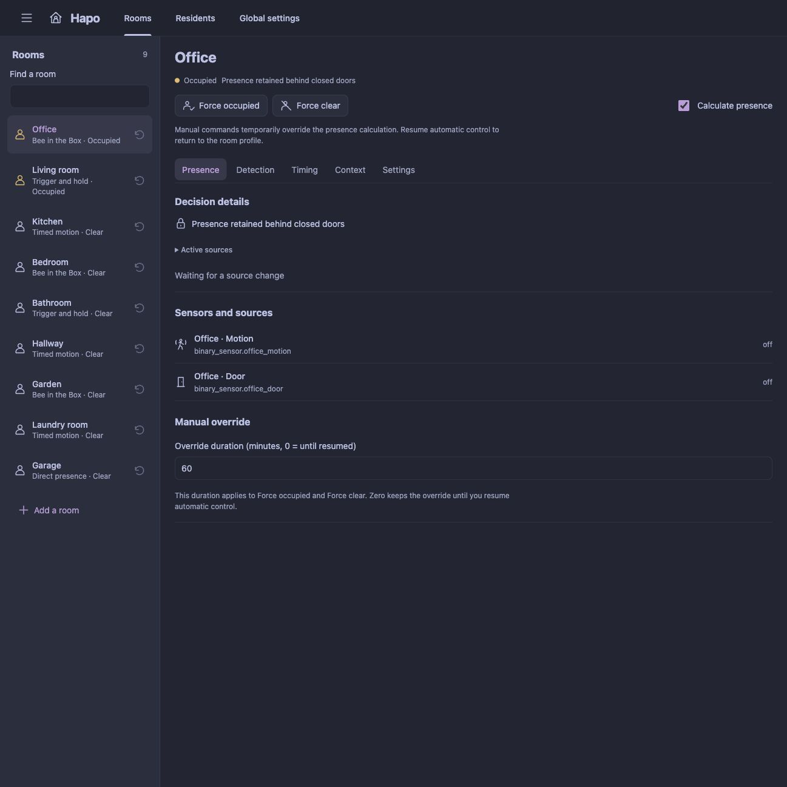
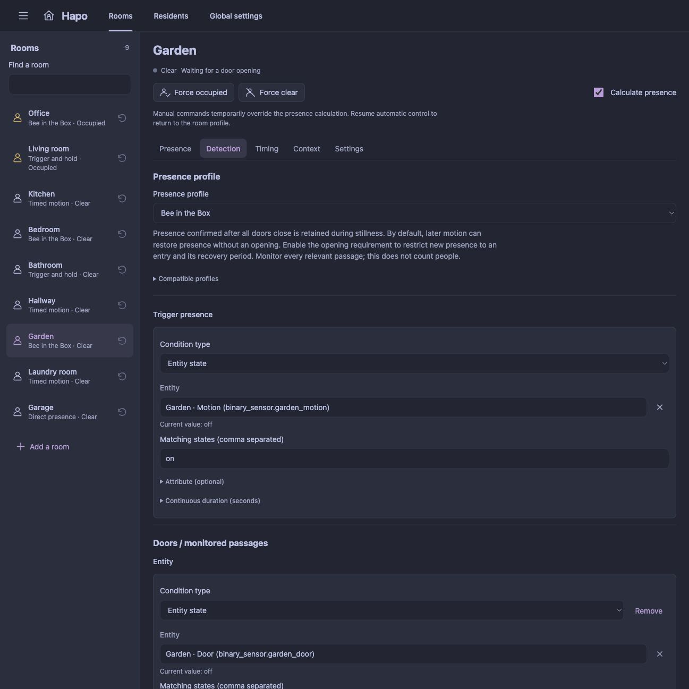
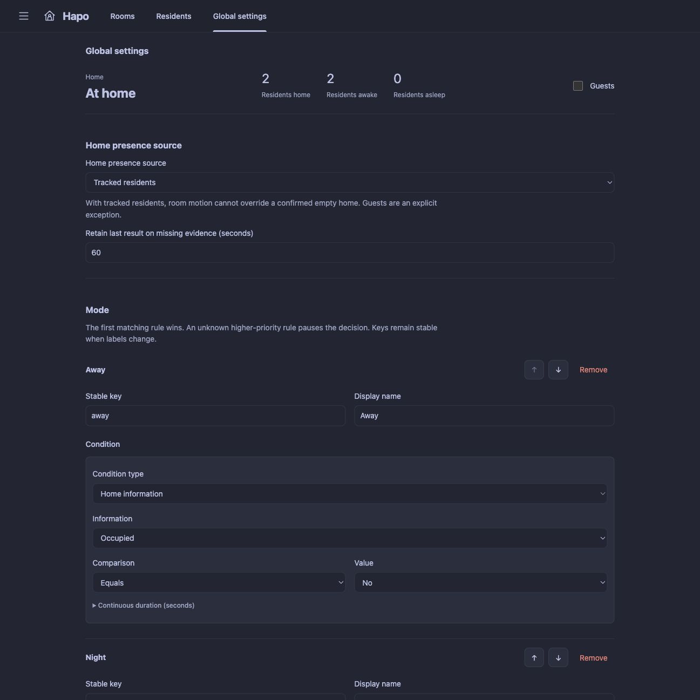

<p align="center">
  
</p>

# Hapo - Home Assistant Presence Orchestrator

[](https://github.com/Gnol86/Hapo/releases/latest)
[](#with-hacs)
[](https://github.com/Gnol86/Hapo/releases)
[](https://github.com/Gnol86/Hapo)

<sub>The download badge counts GitHub release assets only. It does not measure source archive downloads or HACS installations.</sub>

**Presence that follows your home, room by room.**

**Hapo** stands for **Home Assistant Presence Orchestrator**. It brings room presence, resident sleep and home modes together in one local Home Assistant integration. Configure your rooms from a dedicated sidebar panel, understand why a room is occupied, and reuse its presence sensors in your automations.

English · [Français](docs/README.fr.md) · [Releases](https://github.com/Gnol86/Hapo/releases) · [Report an issue](https://github.com/Gnol86/Hapo/issues)

One integration covers your home. The panel follows the same layout as [Halo](https://github.com/Gnol86/Halo), with a room list, a focused detail view and settings grouped into tabs. It follows your Home Assistant theme and works on desktop and mobile. No YAML or separate dashboard card is required to configure Hapo. Its engine runs inside Home Assistant and keeps working when the panel is closed.

Hapo belongs to the Haxo family and works independently of Halo and Havo. Its native presence entities can be used by either integration or by ordinary Home Assistant automations.

<a href="docs/images/room-presence-en.jpg">
  
</a>

*See each room's presence and the reason behind it from one panel. Screenshots show the local preview with demonstration data.*

## What Hapo can do

| Feature | What it brings to your home |
| --- | --- |
| **Room presence** | Choose among six profiles, from direct sensors and timed motion to Bee in the Box and contextual rules. Expose each result as a native occupancy binary sensor. |
| **Bee in the Box** | Remember presence behind monitored doors during stillness. Optionally require an opening before accepting new presence, with a per-room recovery period for late detections. |
| **Residents and sleep** | Track existing person or device tracker entities, confirm arrival and departure, and combine automatic sleep conditions with manual sleep commands. |
| **Home modes** | Choose the presence authority for your home, order mode rules and keep stable mode keys for your automations. |
| **Conditions and delays** | Combine entity states, attributes, numeric thresholds, time ranges and other rooms with explicit confirmation and absence delays. |
| **Manual controls** | Keep a room occupied or clear, set a home mode, manage guests or change a resident's sleep state. Release overrides to resume automatic evaluation. |
| **Decision details** | See the current reason, retained presence, source evidence and next deadline. Missing data is represented explicitly. |

The panel includes searchable room and entity lists, live status and visual condition editing. English and French are included; regional French locales use French, and unsupported languages fall back to English. Custom room, resident and mode names stay unchanged.

### Choose a presence profile

| Profile | Use it when |
| --- | --- |
| Direct presence | A radar, seat or bed sensor maintains a reliable occupied state. |
| Timed motion | Motion starts presence; an inactivity delay ends it. |
| Separate trigger and hold | A PIR starts presence; a radar, door or other condition may only keep it active. |
| Bee in the Box | Monitored doors enclose a space where motion should remain remembered during stillness. |
| Logical combination | AND, OR and NOT combine states, attributes, numeric thresholds and time ranges. |
| Contextual presence | Local activity starts presence; household facts or other rooms determine when it may continue or end. |

The panel suggests compatible profiles from Home Assistant areas, device assignments and sensor classes. **Nothing is selected or saved automatically.** A shared door can be used in several rooms. See [profiles and rules](docs/rules.md) for the detailed behavior.

## Requirements

- **Home Assistant 2026.10.0 or newer.**
- Existing presence sources, such as motion sensors, radar sensors or other state entities. Bee in the Box also needs monitored door sensors.
- Existing person, device tracker or other state entities for any residents you want to track.
- An administrator account to install Hapo and change its configuration. Commands respect Home Assistant entity control permissions.
- HACS for the installation method below, or access to your Home Assistant configuration directory for manual installation.

Sensor quality and placement determine how well an installation can infer presence. Hapo does not identify or count people from motion sensors. Tracked resident counts and room occupancy remain separate facts.

## Installation

### With HACS

Add Hapo as a custom repository:

1. In **HACS**, open the three-dot menu and select **Custom repositories**.
2. Add `https://github.com/Gnol86/Hapo` with the type **Integration**.
3. Search for **Hapo**, open its entry and download it.
4. Restart Home Assistant.
5. Go to **Settings → Devices & services → Add integration**, search for **Hapo** and confirm setup.
6. Open **Hapo** in the sidebar.

After downloading Hapo and restarting Home Assistant, you can also open its setup wizard directly:

[](https://my.home-assistant.io/redirect/config_flow_start/?domain=hapo)

On first use, My Home Assistant may ask for the URL of your Home Assistant instance. Add Hapo once: the same integration manages every configured room and resident. Distribution through a custom repository does not mean inclusion in the default HACS catalog.

### Manual installation

1. Download the source archive from a [published release](https://github.com/Gnol86/Hapo/releases).
2. Copy its `custom_components/hapo` folder into your Home Assistant configuration directory, so that `custom_components/hapo/manifest.json` exists there.
3. Restart Home Assistant, then add **Hapo** from **Settings → Devices & services → Add integration**.

The compiled panel and brand images are included. Node.js and a frontend build are not needed on Home Assistant.

### Updating

Update Hapo through HACS, or replace the `custom_components/hapo` folder with the one from the chosen release. Restart Home Assistant and reload your browser to load the updated panel. Read the [release notes](https://github.com/Gnol86/Hapo/releases) for changes and compatibility information, or the [migration guide](docs/migration.md) when replacing an existing presence setup.

## Set up your first room

1. Open **Hapo → Rooms**, add a room and select its Home Assistant area.
2. In **Detection**, choose a profile and its sources. Apply a compatible suggestion explicitly, or configure the sources yourself. Bee also uses the monitored doors selected here.
3. In **Timing**, adjust presence confirmation, absence and any profile-specific timings. Bee's optional opening requirement has a recovery period of **120 seconds by default, configurable per room**.
4. In **Context**, optionally configure the context and release conditions. Use **Settings** for the room's name and area. The presence calculation toggle stays above the room tabs.
5. Select **Save changes**. Use **Presence** to see the result, inspect its reason and temporarily control occupancy when needed.
6. In **Residents**, add existing location entities, their home states and confirmation delays. In **Global settings**, select the home's presence authority and arrange its mode rules.

Changes remain in a shared draft as you move between tabs, rooms and residents. Live updates preserve the draft. A conflicting revision from another browser blocks overwriting it; export your draft before discarding it if you want to preserve both versions.

Each room exposes a native occupancy binary sensor, manual controls, its decision reason and its next deadline. Home devices expose presence, a mode sensor, known resident counts and a guest switch. Residents expose presence, sleep and sleep commands.

## A closer look

### Detection and door-aware presence

Choose a profile, its trigger and hold sources, and the monitored doors. Suggestions help identify compatible sensors; you decide which ones to use. **Timing** keeps continuous motion confirmation, door stabilization and Bee's recovery period separate, so you can tune them to your sensors.

<a href="docs/images/room-detection-en.jpg">
  
</a>

*A room's detection settings in the local preview, with demonstration data.*

### Residents and home modes

Choose tracked residents, an external condition or selected rooms as the home's presence authority. Order your mode rules, manage guests and see the current result. Residents have their own location and optional automatic sleep conditions.

<a href="docs/images/home-settings-en.jpg">
  
</a>

*Global settings in the local preview, with demonstration data. These captures do not validate behavior in a household installation.*

## How home presence and sleep work

The default modes have stable keys: `away`, `sleeping`, `quiet`, `active` (French labels: Vide, Dort, Calme, Vie). Rename their labels or add and reorder rules. The first true rule wins. An indeterminate higher-priority rule prevents a potentially incorrect lower-priority result.

For residents, configure the states that mean home. All other known locations, including named zones, mean away. With tracked residents as the home authority, room activity cannot contradict a confirmed empty home. **Guests** is an explicit exception and makes total person counts uncertain. Counts always refer to tracked residents; occupied rooms are never added together to estimate people.

Manual sleep commands take priority until released or until a confirmed departure. A missing tracker does not clear a sleep override. A mode override changes the displayed mode, not the underlying presence facts.

## Automations and commands

Use the entities shown under **Settings → Devices & services → Hapo**. Stable room and resident identifiers are available in the panel. Names can change without changing those identifiers.

```yaml
# Keep a room occupied for 30 minutes, then resume its profile.
action: hapo.room_override
data:
  target_id: office
  value: occupied
  duration: 1800
```

| Action | Values | Additional fields |
| --- | --- | --- |
| `hapo.room_override` | `occupied`, `clear`, `auto` | `target_id`; optional `duration` in seconds |
| `hapo.home_override` | A stable mode key, or `auto` | Optional `duration` in seconds |
| `hapo.sleep` | `sleeping`, `awake`, `auto`, `toggle` | `target_id` of the resident |
| `hapo.guests` | `true`, `false` | — |

Zero duration means until explicitly released. Native select entities offer the same indefinite controls; resume buttons release them. For sleep, departure also releases manual control.

Read the mode sensor's **state key**, not its translated name. Its `mode_name` and `modes` attributes expose custom labels. For a departure-triggered action, use a state transition from a known occupied mode, so an `unknown → away` recovery does not inadvertently start an appliance.

## Reliability and privacy

Conditions use true / false / indeterminate values. Missing entities, `unknown`, `unavailable` and invalid numbers do not become false. If remaining evidence cannot decide, the last result is retained with `degraded: true` for a configurable period (300 seconds initially), then the entity publishes `unknown`.

Configuration, confirmed results, overrides and debounce deadlines persist locally. At startup, evaluation waits for Home Assistant to start. Matching current evidence resumes a pending debounce deadline; changed evidence cancels it. Continuous-duration conditions start fresh. By default, after a restart or recovery from lost door continuity, Bee discards the old latch and resumes normal sensor evaluation: without confirmed presence, the room becomes clear after closure stabilization and its configured absence delay. Later motion can restore occupancy without opening a door. Missing sensor information still uses the degraded-state rules above; Hapo never invents an opening or motion event.

Bee also offers **Require an opening before new presence**, disabled by default. When enabled, a clear room ignores motion until a monitored door opens. After all doors close and stabilize, a recovery period allows late detections or another attempt after an interrupted confirmation: **120 seconds by default, configurable per room**. Motion never extends that deadline. Confirmed presence remains retained during stillness; after a restart or lost door continuity, a closed room needs another opening. See the [Bee timing and recovery rules](docs/rules.md#require-an-opening-before-new-bee-presence).

Room and home dependencies are validated as a graph. Cycles are rejected before saving. Updates use state events and scheduled deadlines, with no general polling loop. Native activity entries name Hapo and the affected entity, explain the decision, and preserve the causal context. Exported integration diagnostics omit entity IDs, names, locations and raw state values. **Configuration exports do contain your entity IDs and names.**

Administrators configure Hapo; commands respect Home Assistant entity control permissions. Diagnostic exports are available through the integration's standard diagnostic download.

## Development

Bug reports and contributions are welcome. When [opening an issue](https://github.com/Gnol86/Hapo/issues), include your Hapo and Home Assistant versions, the relevant presence profile and sensor integrations, steps to reproduce, and expected versus observed behavior.

Run Python checks from the repository root:

```sh
uv sync --frozen
uv run --frozen ruff check .
uv run --frozen ruff format --check .
uv run --frozen pytest
```

For panel changes, use Node.js 24 and run these commands from the repository root:

```sh
npm ci
npm run check
npm test
npm run build
```

Include the generated `custom_components/hapo/frontend/hapo-panel.js` with your changes. CI checks that rebuilding it produces no diff, runs Python and panel tests, and validates the integration with Hassfest. HACS validation is also part of the release workflow. Release versions must match the manifest, Python project, lockfile and `releases/<version>.md`.

See [development notes](docs/development.md) for the engine boundaries and acceptance scenarios. Automated tests and simulated previews do not validate sensor placement, hardware behavior or presence inference in a household installation.

## License

Hapo is released under the [MIT License](LICENSE). The included panel bundles Lit under its BSD-3-Clause license.
