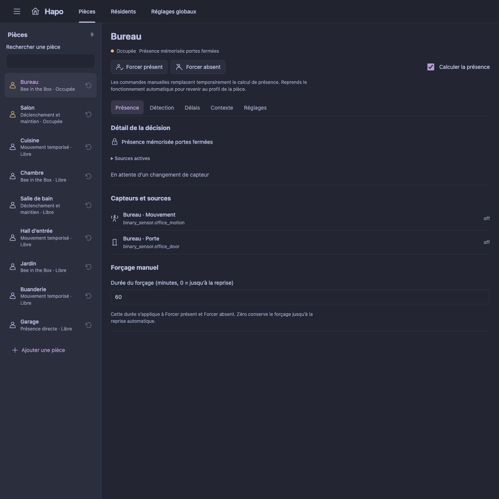
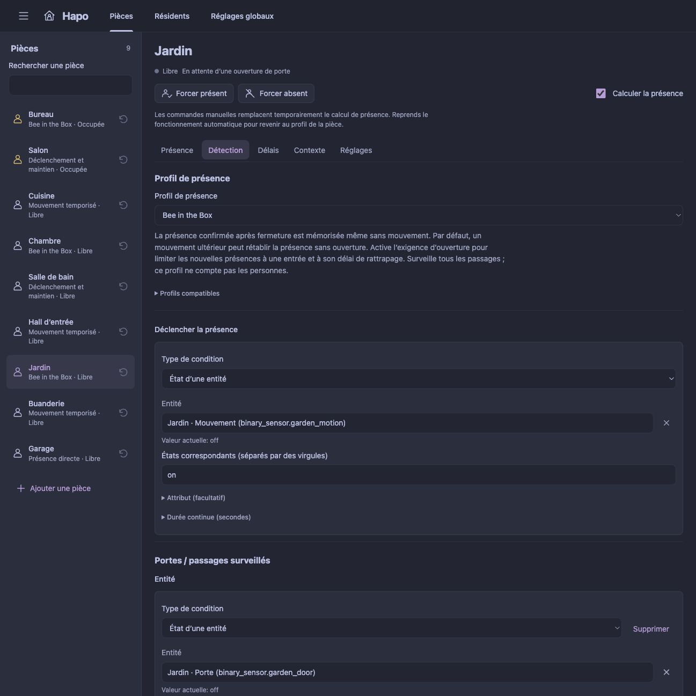
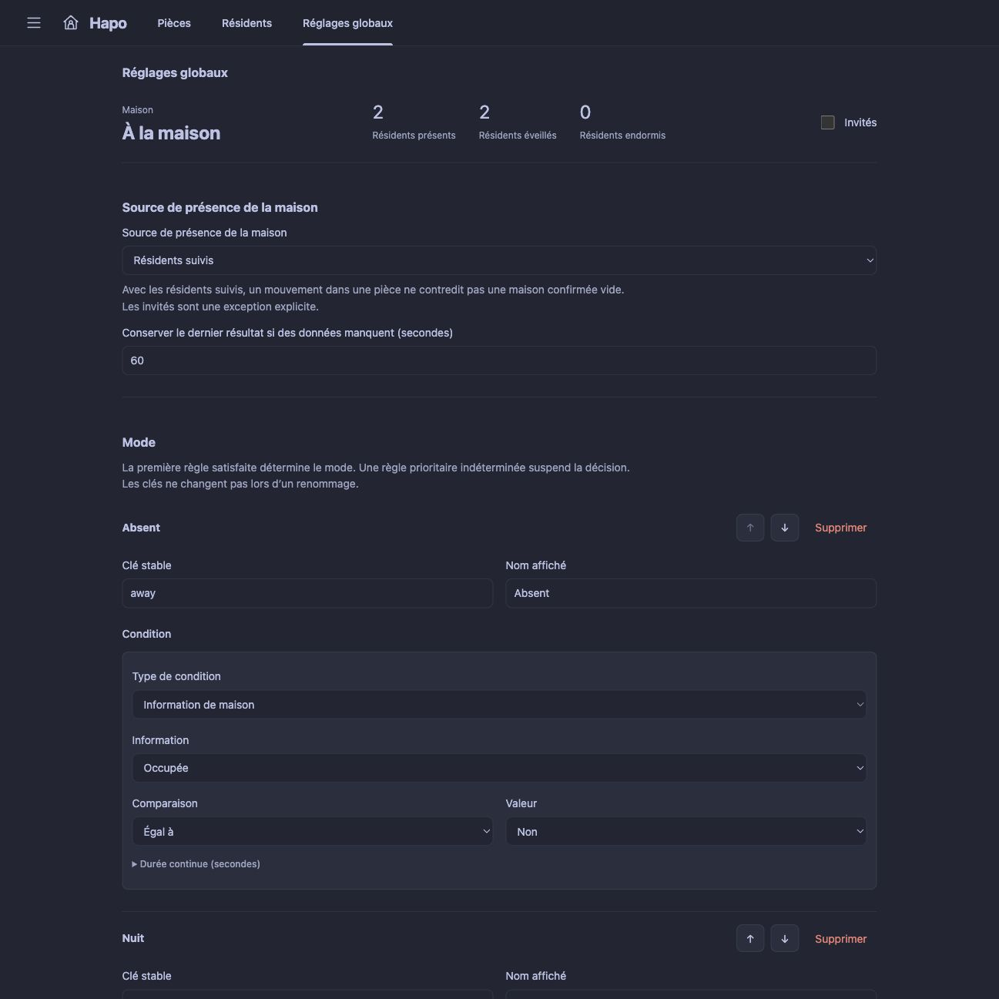

<p align="center">
  
</p>

# Hapo - Home Assistant Presence Orchestrator

[](https://github.com/Gnol86/Hapo/releases/latest)
[](#avec-hacs)
[](https://github.com/Gnol86/Hapo/releases)
[](https://github.com/Gnol86/Hapo)

<sub>Le badge de téléchargements compte uniquement les fichiers joints aux releases GitHub. Il ne mesure ni les téléchargements des archives du code source ni les installations HACS.</sub>

**Une présence qui suit ta maison, pièce par pièce.**

**Hapo** signifie **Home Assistant Presence Orchestrator**. Cette intégration locale pour Home Assistant réunit la présence des pièces, le sommeil des résidents et les modes de maison. Configure tes pièces depuis un panneau dédié, comprends pourquoi une pièce est occupée et réutilise ses capteurs de présence dans tes automatisations.

[English](../README.md) · Français · [Versions](https://github.com/Gnol86/Hapo/releases) · [Signaler un problème](https://github.com/Gnol86/Hapo/issues)

Une seule intégration gère toute la maison. Le panneau reprend la disposition de [Halo](https://github.com/Gnol86/Halo), avec une liste de pièces, une vue détaillée et des réglages regroupés par onglet. Il suit le thème Home Assistant et s'adapte aux ordinateurs et aux mobiles. Aucun YAML ni carte de tableau de bord séparée n'est nécessaire pour configurer Hapo. Le moteur fonctionne dans Home Assistant et continue lorsque le panneau est fermé.

Hapo fait partie de la famille Haxo et fonctionne indépendamment de Halo et Havo. Ses entités de présence natives sont utilisables dans ces intégrations et dans les automatisations Home Assistant ordinaires.

<a href="images/room-presence-fr.jpg">
  
</a>

*Retrouve la présence de chaque pièce et son explication dans un seul panneau. Les captures montrent l'aperçu local avec des données de démonstration.*

## Ce que Hapo peut faire

| Fonction | Ce qu'elle apporte à ta maison |
| --- | --- |
| **Présence des pièces** | Choisis parmi six profils, des capteurs directs et mouvements temporisés à Bee in the Box et aux règles contextuelles. Chaque résultat devient un capteur binaire d'occupation natif. |
| **Bee in the Box** | Mémorise la présence derrière les portes surveillées, même sans mouvement. Exige éventuellement une ouverture avant une nouvelle présence, avec un délai de rattrapage par pièce pour les détections tardives. |
| **Résidents et sommeil** | Suis les entités de personne ou de localisation existantes, confirme les arrivées et départs, et combine les conditions de sommeil automatique avec des commandes manuelles. |
| **Modes de maison** | Choisis l'autorité de présence de la maison, organise les règles des modes et conserve des clés de mode stables pour tes automatisations. |
| **Conditions et délais** | Combine les états et attributs d'entités, les seuils numériques, les horaires et les autres pièces avec des délais explicites de confirmation et d'absence. |
| **Commandes manuelles** | Force une pièce présente ou vide, choisis un mode de maison, gère les invités ou modifie le sommeil d'un résident. Libère les forçages pour reprendre l'évaluation automatique. |
| **Détails des décisions** | Consulte le motif actuel, la présence mémorisée, les sources utilisées et la prochaine échéance. Les données manquantes sont signalées explicitement. |

Le panneau propose des listes de pièces et d'entités avec recherche, des états en direct et un éditeur visuel de conditions. L'anglais et le français sont inclus ; les variantes régionales françaises utilisent le français, et les langues non prises en charge utilisent l'anglais. Les noms personnalisés des pièces, résidents et modes restent inchangés.

### Choisir un profil de présence

| Profil | Usage |
| --- | --- |
| Présence directe | Suivre un radar, un capteur de siège ou de lit qui maintient un état occupé fiable. |
| Mouvement temporisé | Déclencher sur mouvement, puis attendre une période sans activité. |
| Déclenchement et maintien séparés | Un PIR déclenche ; un radar, une porte ou une autre condition peuvent uniquement prolonger la présence. |
| Bee in the Box | Mémoriser une présence derrière des portes surveillées, même sans mouvement. |
| Combinaison logique | Combiner ET, OU, NON, états, attributs, valeurs numériques et horaires. |
| Présence contextuelle | Déclencher localement, puis maintenir ou terminer selon les résidents et les autres pièces. |

Hapo propose des profils en fonction des pièces Home Assistant, des appareils et des classes de capteurs. **Rien n'est sélectionné ni enregistré automatiquement.** Une porte partagée peut être utilisée dans plusieurs pièces. Consulte les [profils et règles](rules.fr.md) pour le fonctionnement détaillé.

## Prérequis

- **Home Assistant 2026.10.0 ou plus récent.**
- Des sources de présence existantes, par exemple des détecteurs de mouvement, radars ou autres entités d'état. Bee in the Box nécessite aussi des capteurs de porte surveillés.
- Des entités de personne, de localisation ou d'état existantes pour les résidents que tu souhaites suivre.
- Un compte administrateur pour installer Hapo et modifier sa configuration. Les commandes respectent les droits de contrôle des entités Home Assistant.
- HACS pour la méthode ci-dessous, ou un accès au dossier de configuration Home Assistant pour une installation manuelle.

Le placement et la qualité des capteurs déterminent la fiabilité des déductions. Hapo ne reconnaît ni ne compte les personnes à partir des mouvements. Le nombre de résidents suivis et l'occupation des pièces restent des informations distinctes.

## Installation

### Avec HACS

Ajoute Hapo comme dépôt personnalisé :

1. Dans **HACS**, ouvre le menu à trois points et choisis **Dépôts personnalisés**.
2. Ajoute `https://github.com/Gnol86/Hapo` avec le type **Intégration**.
3. Recherche **Hapo**, ouvre sa fiche et télécharge-le.
4. Redémarre Home Assistant.
5. Ouvre **Paramètres → Appareils et services → Ajouter une intégration**, recherche **Hapo** et confirme l'installation.
6. Ouvre **Hapo** dans la barre latérale.

Après le téléchargement de Hapo et le redémarrage de Home Assistant, tu peux aussi ouvrir directement son assistant d'installation :

[](https://my.home-assistant.io/redirect/config_flow_start/?domain=hapo)

Lors de la première utilisation, My Home Assistant peut te demander l'adresse de ton instance. Ajoute Hapo une seule fois : la même intégration gère toutes les pièces et tous les résidents configurés. Un dépôt personnalisé HACS ne signifie pas une inscription au catalogue HACS par défaut.

### Installation manuelle

1. Télécharge l'archive du code source d'une [version publiée](https://github.com/Gnol86/Hapo/releases).
2. Copie son dossier `custom_components/hapo` dans le dossier de configuration de Home Assistant, afin d'y retrouver `custom_components/hapo/manifest.json`.
3. Redémarre Home Assistant, puis ajoute **Hapo** depuis **Paramètres → Appareils et services → Ajouter une intégration**.

Le panneau compilé et les images de marque sont inclus. Node.js et une compilation de l'interface ne sont pas nécessaires sur Home Assistant.

### Mise à jour

Mets Hapo à jour depuis HACS ou remplace le dossier `custom_components/hapo` par celui de la version choisie. Redémarre Home Assistant puis recharge le navigateur pour charger le nouveau panneau. Consulte les [notes de version](https://github.com/Gnol86/Hapo/releases) pour les changements et la compatibilité, ou le [guide de migration](migration.fr.md) si tu remplaces une configuration de présence existante.

## Configurer ta première pièce

1. Ouvre **Hapo → Pièces**, ajoute une pièce et sélectionne sa pièce Home Assistant.
2. Dans **Détection**, choisis un profil et ses sources. Applique explicitement une suggestion compatible ou configure toi-même les sources. Bee utilise également les portes surveillées sélectionnées ici.
3. Dans **Délais**, règle la confirmation de présence, l'absence et les temporisations propres au profil. L'option Bee exigeant une ouverture dispose d'un rattrapage de **120 secondes par défaut, configurable par pièce**.
4. Dans **Contexte**, configure éventuellement les conditions de contexte et de libération. Utilise **Réglages** pour le nom et la pièce Home Assistant. L'interrupteur du calcul de présence reste au-dessus des onglets de la pièce.
5. Choisis **Enregistrer**. L'onglet **Présence** affiche le résultat, son motif et les commandes permettant de forcer temporairement l'occupation.
6. Dans **Résidents**, ajoute les entités de localisation existantes, leurs états signifiant « à la maison » et leurs délais de confirmation. Dans **Réglages globaux**, choisis l'autorité de présence de la maison et organise les règles de ses modes.

Les modifications restent dans un brouillon partagé lorsque tu changes d'onglet, de pièce ou de résident. Les mises à jour en direct le conservent. Une modification depuis un autre navigateur bloque une sauvegarde concurrente ; exporte ton brouillon avant de l'abandonner pour conserver les deux versions.

Chaque pièce expose un capteur binaire d'occupation natif, des commandes manuelles, le motif de sa décision et sa prochaine échéance. La maison expose sa présence, un capteur de mode, les comptes connus de résidents et un interrupteur d'invités. Chaque résident expose sa présence, son sommeil et les commandes de sommeil.

## L'interface en détail

### Détection et présence avec surveillance des portes

Choisis un profil, ses sources de déclenchement et de maintien, et les portes surveillées. Les suggestions aident à repérer les capteurs compatibles ; tu décides lesquels utiliser. **Délais** distingue la confirmation continue du mouvement, la stabilisation des portes et le rattrapage Bee pour les adapter à tes capteurs.

<a href="images/room-detection-fr.jpg">
  
</a>

*Réglages de détection d'une pièce dans l'aperçu local, avec des données de démonstration.*

### Résidents et modes de maison

Choisis les résidents suivis, une condition externe ou certaines pièces comme autorité de présence de la maison. Organise les règles des modes, gère les invités et consulte le résultat actuel. Chaque résident dispose de ses propres sources de localisation et de conditions facultatives de sommeil automatique.

<a href="images/home-settings-fr.jpg">
  
</a>

*Réglages globaux dans l'aperçu local, avec des données de démonstration. Ces captures ne valident pas le comportement d'une installation domestique.*

## Fonctionnement de la présence et du sommeil

Les quatre modes initiaux ont des clés stables : `away` (Vide), `sleeping` (Dort), `quiet` (Calme) et `active` (Vie). Tu peux renommer leurs libellés, réordonner leurs règles et créer d'autres modes. La première règle vraie gagne. Une règle prioritaire indéterminée bloque une conclusion potentiellement incorrecte issue d'une règle suivante.

Pour les résidents, configure les états qui signifient « à la maison ». Les autres localisations connues, y compris les zones nommées, signifient une absence. Avec les résidents comme autorité de présence de la maison, une pièce occupée ne contredit pas un départ confirmé. L'exception **Invités** est explicite et rend le nombre total de personnes incertain. Les compteurs portent uniquement sur les résidents suivis ; Hapo n'additionne jamais les pièces pour compter des personnes.

Le sommeil manuel reste prioritaire jusqu'à sa libération ou un départ confirmé. Un tracker indisponible ne l'efface pas. Un mode de maison forcé change le mode affiché, pas les faits de présence.

## Automatisations et commandes

Utilise les entités regroupées dans **Paramètres → Appareils et services → Hapo**. Les identifiants stables des pièces et résidents sont disponibles dans le panneau. Ils restent inchangés lors d'un renommage.

```yaml
# Maintenir une pièce occupée pendant 30 minutes, puis reprendre son profil.
action: hapo.room_override
data:
  target_id: office
  value: occupied
  duration: 1800
```

| Action | Valeurs | Paramètres complémentaires |
| --- | --- | --- |
| `hapo.room_override` | `occupied`, `clear`, `auto` | `target_id` ; `duration` facultative en secondes |
| `hapo.home_override` | Clé stable d'un mode, ou `auto` | `duration` facultative en secondes |
| `hapo.sleep` | `sleeping`, `awake`, `auto`, `toggle` | `target_id` du résident |
| `hapo.guests` | `true`, `false` | — |

Une durée nulle maintient le forçage jusqu'à sa libération explicite. Les sélecteurs natifs offrent ces commandes sans durée ; les boutons de reprise les libèrent. Un départ confirmé libère aussi le sommeil manuel.

Dans les automatisations, compare la **clé d'état** du capteur de mode, pas son libellé traduit. Les attributs `mode_name` et `modes` exposent les noms personnalisés. Pour déclencher un appareil au départ, exige une transition depuis un mode occupé connu : une récupération `unknown → away` ne doit pas être prise pour un nouveau départ.

## Fiabilité et confidentialité

Un capteur manquant, `unknown`, `unavailable` ou une valeur numérique invalide ne devient pas absent. Les conditions ont trois résultats : vrai, faux ou indéterminé. Lorsque les sources restantes ne permettent plus de conclure, Hapo conserve le dernier résultat avec `degraded: true` pendant un délai configurable, initialement cinq minutes, puis publie `unknown`.

La configuration, les résultats confirmés, les forçages et les échéances de confirmation sont conservés localement. Au redémarrage, Hapo attend que Home Assistant soit démarré : une source toujours compatible reprend son échéance, une source modifiée l’annule. Les conditions exigeant une durée continue recommencent leur confirmation. Par défaut, après un redémarrage ou le rétablissement des capteurs de porte, Bee abandonne l’ancienne mémoire et reprend l’évaluation normale : sans présence confirmée, la zone est considérée vide après stabilisation et délai d’absence configuré. Un mouvement ultérieur rétablit la présence, sans devoir ouvrir une porte. Les informations de capteur manquantes suivent toujours les règles de dégradation décrites ci-dessus ; Hapo n'invente jamais une ouverture ni un mouvement.

Bee propose aussi **Exiger une ouverture avant une nouvelle présence**, désactivé par défaut. Une fois l’option activée, une pièce vide ignore les mouvements jusqu’à l’ouverture d’une porte surveillée. Après fermeture et stabilisation de toutes les portes, un délai de rattrapage autorise les détections tardives ou une nouvelle tentative après interruption de la confirmation : **120 secondes par défaut, configurables par pièce**. Les mouvements ne prolongent jamais cette échéance. La présence confirmée reste mémorisée sans mouvement ; après un redémarrage ou une perte de continuité des portes, une pièce fermée nécessite une nouvelle ouverture. Consulte les [règles de temporisation et de rattrapage Bee](rules.fr.md#exiger-une-ouverture-avant-une-nouvelle-présence-bee).

Les dépendances des pièces et de la maison forment un graphe validé avant enregistrement ; les cycles sont refusés. Le moteur utilise les événements d'état et les échéances utiles, sans boucle générale de scrutation. L’activité native indique Hapo, l’entité concernée et le motif du changement, en conservant le contexte causal. Les diagnostics téléchargeables depuis l’intégration sont expurgés des noms, identifiants d’entités, localisations et valeurs brutes. **Un export de configuration contient tes noms et identifiants.**

Les administrateurs configurent l’intégration. Les commandes respectent les droits de contrôle des entités Home Assistant. Les diagnostics sont accessibles depuis le téléchargement standard proposé par l'intégration.

## Développement

Les signalements et contributions sont les bienvenus. Lorsque tu [ouvres un ticket](https://github.com/Gnol86/Hapo/issues), indique les versions de Hapo et Home Assistant, le profil de présence et les intégrations des capteurs concernés, les étapes de reproduction et le résultat attendu par rapport au résultat observé.

Lance les contrôles Python depuis la racine du dépôt :

```sh
uv sync --frozen
uv run --frozen ruff check .
uv run --frozen ruff format --check .
uv run --frozen pytest
```

Pour les modifications du panneau, utilise Node.js 24 et lance ces commandes depuis la racine du dépôt :

```sh
npm ci
npm run check
npm test
npm run build
```

Inclus le fichier généré `custom_components/hapo/frontend/hapo-panel.js` avec tes modifications. La CI vérifie qu'une recompilation ne produit aucune différence, exécute les tests Python et du panneau, puis valide l'intégration avec Hassfest. Le workflow de publication vérifie également HACS. La version publiée doit correspondre au manifeste, au projet Python, au fichier de verrouillage et à `releases/<version>.md`.

Consulte les [notes de développement](development.md) pour les responsabilités du moteur et les scénarios d'acceptation. Les tests automatiques et aperçus simulés ne valident pas le placement des capteurs, le comportement matériel ni les déductions de présence dans une installation domestique.

## Licence

Hapo est distribué sous [licence MIT](../LICENSE). Le panneau inclut Lit sous licence BSD-3-Clause.
